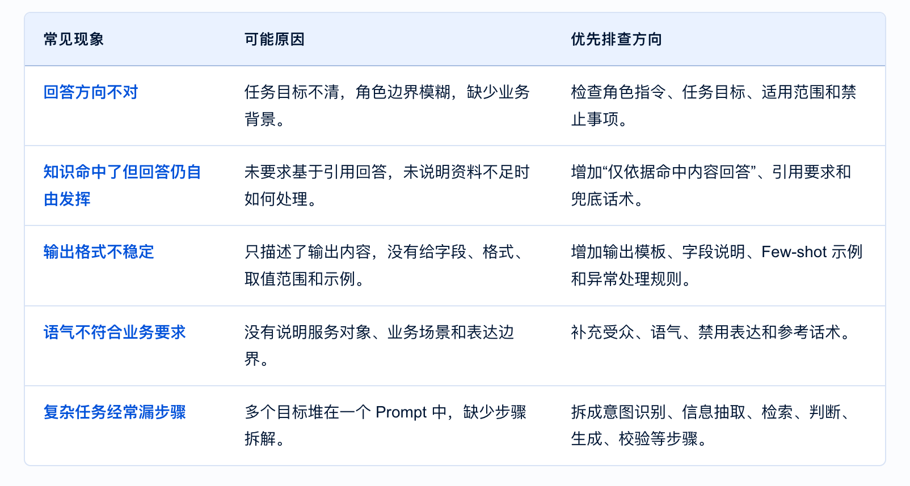
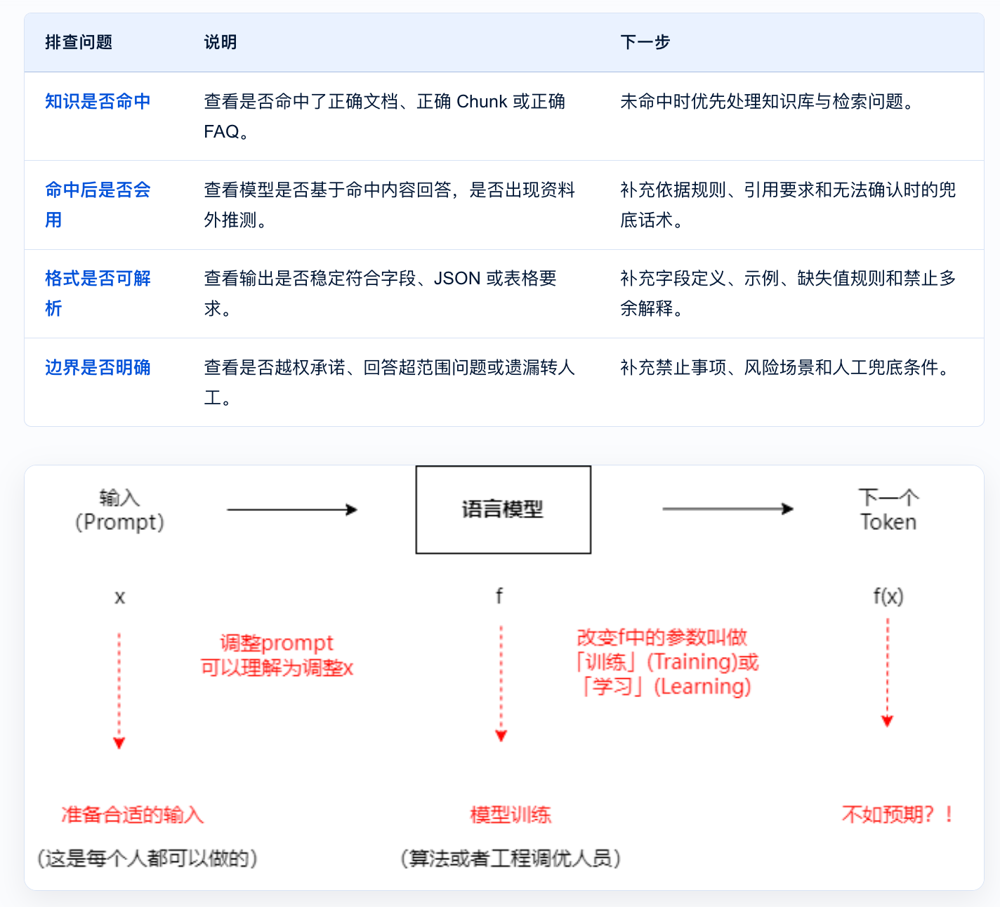
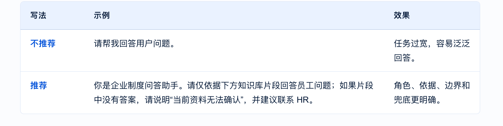
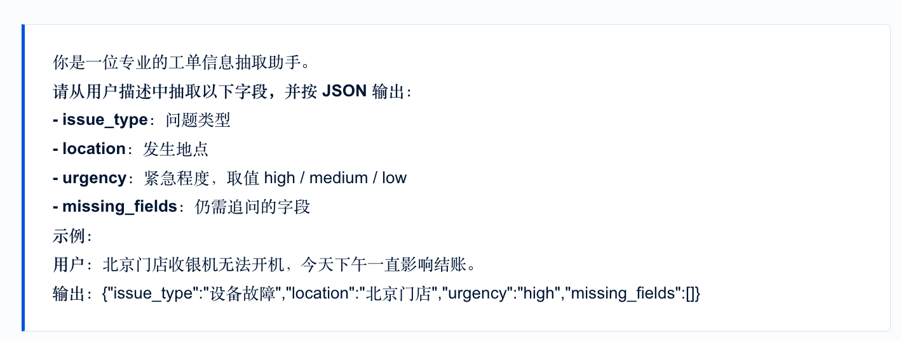
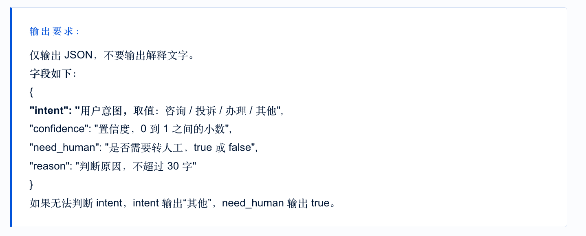
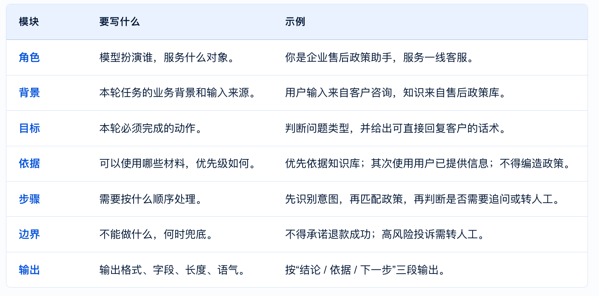
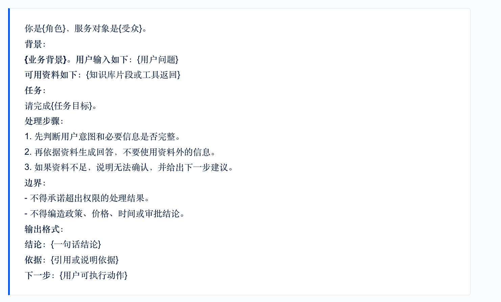
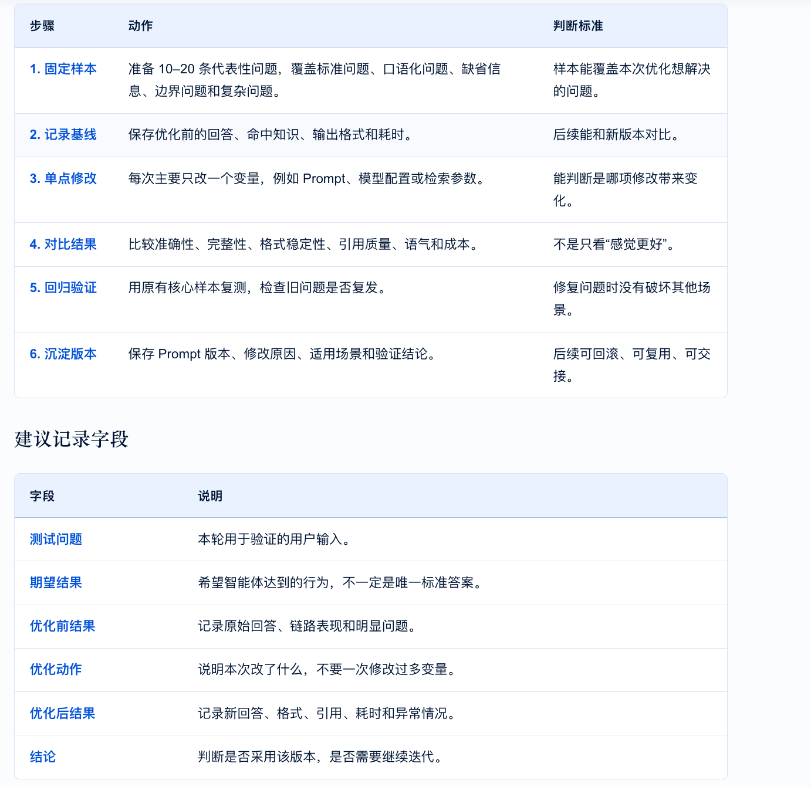

一、Prompt 调优

从问题定位、提示词优化到效果验证，提升智能体回答稳定性

当智能体出现答非所问、格式不稳定、知识不引用、工具参数错误或语气不一致时，优先不要只判断“模型不行”。更有效的做法是先定位问题来源，再通过 Prompt、上下文、模型配置和测试样本逐步优化。

Prompt 为什么效果不好

Prompt 效果不好，通常不是因为某一句话写得不够长，而是任务、依据、边界、格式、上下文或模型配置中有关键要素缺失。调试时应先定位问题来源，再决定改 Prompt、改知识库、改工作流，还是调整模型配置。

可以把 Prompt 理解成给模型的一份“任务说明书”。如果说明书只写“帮我回答一下”，模型虽然会给出回复，但不一定知道应该面向谁回答、依据哪份资料回答、哪些内容不能推测、输出要不要给引用、后续节点是否需要固定字段。因此，Prompt 调优的第一步不是马上改写，而是先问：这个问题到底是“没听懂任务”，还是“没有拿到正确依据”，或者是“输出格式没有被约束”。

在 ADP 应用中，还要注意 Prompt 与知识库、工作流、模型配置等是一起生效的，例如知识库没有命中正确内容时，单纯加长 Prompt 通常不能解决根因。

核心判断

如果问题出在知识没有命中，优先优化知识库和 RAG；
如果问题出在命中后不会用、格式不稳定、意图执行不准，优先优化 Prompt；
如果问题出在复杂推理、长上下文处理或工具规划能力不足，再结合模型配置和应用模式一起调整。

二、Prompt 调优的常用方法

（1）指令清晰：说清楚角色、任务、依据和限制
清晰的 Prompt 至少要回答四个问题：模型现在扮演什么角色、要完成什么任务、必须依据什么信息、不能做什么。
角色决定回答口吻和责任边界，任务决定本轮要完成的动作，依据决定模型能使用哪些信息，限制决定哪些情况必须拒答、追问或转人工。

（2）添加示例：让模型模仿正确输出

当输出格式、判断标准或语气要求不容易说清楚时，添加 1–3 个高质量示例通常比继续堆规则更有效。示例会告诉模型“什么样的输入应该对应什么样的输出”，尤其适合信息抽取、标签判断、客服话术、JSON 输出等任务。

示例不是越多越好。示例过多会占用上下文，也可能让模型过度模仿某一个样例。更好的做法是选择少量典型样例：一个标准样例、一个边界样例、一个缺失信息样例。这样模型既能学会正常处理，也能知道遇到不完整或高风险输入时怎么兜底。例如：

（3）问题分解：把复杂任务拆成可验证步骤

复杂任务不要全部压在一个 Prompt 里。更稳定的做法是把任务拆成多个步骤，或在工作流中拆成多个节点。拆解的好处是：每一步目标更单一，输出更容易检查，出现问题时也更容易定位是意图识别、字段抽取、知识检索还是结果生成出了问题。

例如“处理客户投诉”可以拆成：识别是否投诉、提取客户诉求和关键信息、判断风险等级、查询处理规则、生成回复或转人工建议。不要让一个节点同时完成所有动作，否则调试时只能看到最终回答，很难知道中间哪一步发生偏差。

1、先判断用户意图和任务类型。
2、再提取必要字段，缺失时追问。
3、然后查询知识库或调用工具。
4、最后基于结果生成答案，并按格式输出。
5、如果结果不确定，进入兜底或人工处理。

（4）控制输出：给模板、字段和校验规则

如果后续节点需要读取模型输出，Prompt 中必须明确输出结构。只写“请按 JSON 输出”通常不够，还要写字段名、字段含义、取值范围、缺失值处理和禁止输出多余解释。

在工作流中，输出格式不稳定会直接影响后续节点。例如上游输出多了一段解释文字，下游 JSON 解析就可能失败；字段名有时叫 intent、有时叫 user_intent，下游变量也可能读取不到。因此，凡是要进入后续节点的模型输出，都应尽量结构化、字段固定、规则明确。

（5）给模型留出中间选项
不要只给模型“对/错”“能/不能”的二选一。当业务场景存在不确定信息时，应允许模型输出“无法确认”“需补充信息”“建议转人工”等中间结果。例如：

 三、Prompt 模板设计

 Prompt 模板的价值，是把一次有效的调优经验沉淀成可复用结构。实际编写时，可以使用“角色—背景—目标—依据—步骤—边界—输出”的结构。它不要求每次都写很长，但能帮助你检查关键要素是否缺失。

模板不是固定话术，而是一张检查清单。简单问答场景可以只保留角色、依据、边界和输出；复杂工作流节点则需要写清输入变量、处理步骤、输出字段和异常情况。模板设计的重点是让不同搭建者在同类场景下写出的 Prompt 保持一致，便于复用、评审和后续维护。

（1）通用模板

（2）模板使用建议

知识问答类模板重点写清“依据”和“无法确认时的回复”。
信息抽取类模板重点写清字段定义、取值范围和缺失字段处理。
客服回复类模板重点写清语气、禁用表达、风险边界和可复制话术长度。
工作流节点模板重点写清输入变量、输出变量和下游节点可解析格式。

四、Prompt 效果验证与迭代

Prompt 改完后，不能只看当前那一条问题是否变好。正确做法是用固定样本复测，确认同类问题改善，同时没有引入新的问题。

很多调优失败，是因为每次同时改了太多内容：既改 Prompt，又改模型配置，还改知识库和检索参数。这样即使效果变好，也不知道是哪项修改起作用；如果效果变差，也很难回滚。因此建议每轮只改一个主要变量，并保留优化前后的对比记录。

验证样本不需要一开始就很大，但要覆盖关键类型。比如一个客服助手，至少应包含标准问法、口语化问法、资料不足问法、边界问法和高风险问法。上线前再把这些样本扩展成更完整的评测集。

